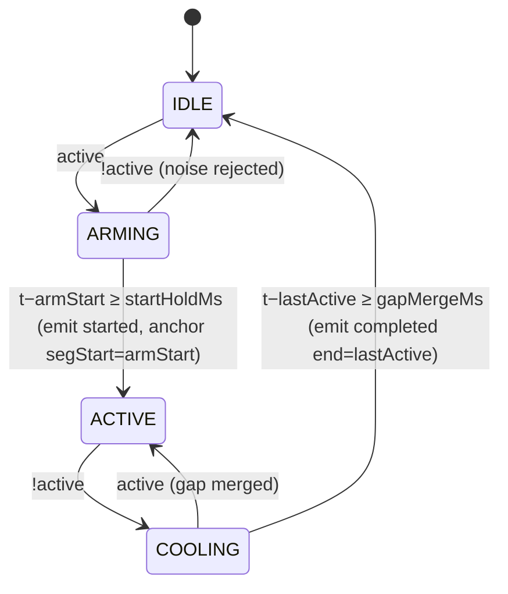

# FrameSheet — Design Document

## 1. Architecture Overview

The "Frankenstein" stitch: a CV pipeline and a spreadsheet engine, normally from different
planets, sharing one reactive event log as the connective tissue.

```mermaid
flowchart LR
  subgraph Sources["Frame Sources (interchangeable)"]
    P[ProceduralSource<br/>pure render(t) synth CCTV]
    V[VideoFileSource<br/>user mp4/webm]
  end
  subgraph Engine["Detection Engine · 10Hz sampler"]
    D[ZoneDetector<br/>192×108 luma grid]
    M[Mode: MOTION<br/>zone frame-diff]
    O[Mode: OBJECT<br/>bg-model → dilate → CC labeling<br/>→ classify → track → zone overlap]
    SM[Hysteresis Segmenter<br/>IDLE→ARMING→ACTIVE→COOLING]
    D --> M --> SM
    D --> O --> SM
  end
  subgraph Store["Studio Store (single source of truth)"]
    Z[ZoneConfig[]]
    EV[FrameEvent[]<br/>+ live segments]
    SH[Sheet cells A1:D6]
    PR[ProofState]
  end
  subgraph Sheet["Formula Engine (pure)"]
    TK[tokenizer] --> PA[recursive-descent parser] --> EVL[evaluator<br/>+ cycle detection<br/>+ proof linkage]
  end
  Sources --> Engine
  SM -->|started/completed| EV
  EV --> Sheet
  SH --> EVL
  EVL -->|proofEventIds| PR
  EV -->|row click| PR
  PR -->|seek(start−0.12) + play until end| Sources
  Z --> Engine
```

Data flow is unidirectional: **Source → Detector → Segmenter → Store → Sheet/Timeline/UI**,
with a single user-initiated back-edge (Click-to-Proof seek). All nondeterminism
(`performance.now`, canvas rasterization) is quarantined at the Source edge; everything past the
detector is pure.

## 2. Key Design Decisions

### D1 — On-device micro-CV instead of cloud models (privacy + reliability)
The brief's "AI Object-in-Zone" mode is satisfied by an embedded classical-CV pipeline
(background model → foreground mask → morphological dilation → connected-component labeling →
aspect/size classification → centroid tracking). Chosen over shipping coco-ssd weights because:
(1) the store's **zero-external-API guarantee** is absolute — no runtime weight downloads;
(2) deterministic behavior offline for judges; (3) <1ms/sample budget on a 192×108 grid.
The classifier thresholds (`person`: aspect ≥ 1.35; `vehicle`: area ≥ 140px or width ≥ 24px
@192; else `package`) are documented constants, demoable live via the dock scenario's
forklift (a `package` deliberately ignored by `vehicle` bays).

### D2 — Stationary dweller problem: background-anchor freezing
Naive background models absorb a motionless person within seconds, splitting one dwell into
many phantom events. FrameSheet marks live track bounding boxes as **frozen** (no adaptation)
and recently-lost regions as **released** (fast re-absorption α=0.3 vs normal α=0.012). This is
what lets a 36s checkout wait remain one segment in OBJECT mode.

### D3 — Retroactive start anchoring
The 800ms start-hold is a confirmation delay, not a data loss: the segment start is the
first sample of the candidate run. A customer who genuinely starts waiting at t=31.0 is logged
at t=31.0, even though confirmation arrives at t=31.8.

### D4 — Pure procedural sources for zero-friction judging
`render(t)` is a pure function; seeking renders any timestamp instantly, the same way every
time. Scenarios embed scripted ground truth (documented per-file) that the engine must
rediscover from pixels — detection is real CV over real rasters, never scripted pass-throughs.

### D5 — One store, two clocks
Structural mutations bump a monotonic `version` (React `useSyncExternalStore`); 10Hz telemetry
(signal meters, blob overlays) travels on a side emitter so only instrument widgets re-render.

## 3. Data Models

```ts
ZoneConfig { id, name /*"Zone_A"*/, label, color, rect∈[0,1]⁴, mode: motion|object,
             targetClass, sensitivity, overlap, startHoldMs, gapMergeMs, enabled }
FrameEvent { id, num, zoneId, zoneName, mode: MOTION|OBJECT|MANUAL,
             start, end, duration /*s*/, peak∈[0,1], verified: AUTO|VERIFIED|EDITED|DISMISSED }
SegmenterState { phase: IDLE|ARMING|ACTIVE|COOLING, armStart, segStart, lastActive, peak }
EvalOutcome { kind: empty|number|text|error, value?, display, error?, proofEventIds? }
```

## 4. State Machines

Segmenter (per zone, per sample at 10Hz):



## 5. Correctness & Testing Strategy

Because the segmenter and formula engine are pure functions, they are validated with
**fast-check property-based tests** (`src/engine/__tests__/`), one property per invariant listed
in requirements.md §Acceptance Invariants (P-NOISE…F-ROBUST), plus an oracle test comparing
COUNT/AVG/SUM/COUNT_OVER against naive recomputation on randomly generated event logs. Rendering
and DOM layers are excluded from PBT and verified by scripted ground-truth scenarios instead.

## 6. Threat & Privacy Model

- No network egress for media: procedural scenes are computed; uploads stay in a local blob URL.
- No persistence: refresh wipes state (explicitly non-goals: accounts, cloud sync).
- Determinism: same inputs → same event log (modulo ≤1 sample quantization ±0.1s).
