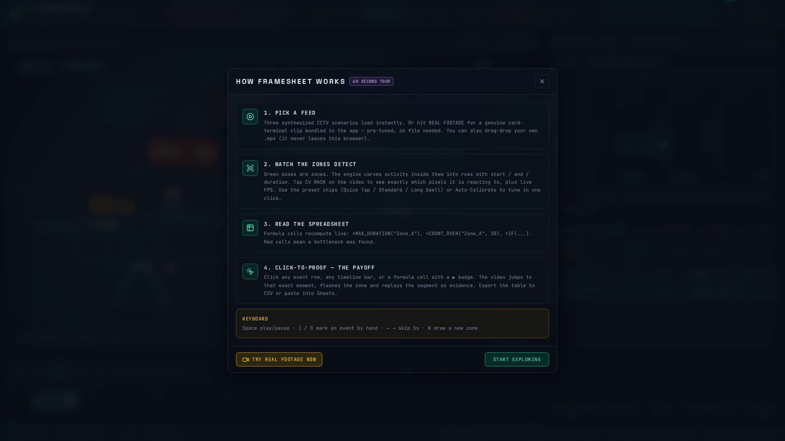

# FrameSheet — Kiroween 2026 · Frankenstein Category



**A client-side computer-vision zone watchdog stitched to a reactive spreadsheet:**
two organisms that should never share a body — a CV event detector and a formula
engine — fused over one live event log, where **every number is clickable video evidence**.

## The Frankenstein Stitch

| Organ 1: CV engine | Organ 2: Spreadsheet | The shared connective tissue |
| --- | --- | --- |
| 10Hz canvas sampler, motion frame-diff + on-device blob tracker (person/vehicle/package), hysteresis state machine | Tokenizer → recursive-descent parser → evaluator with cell refs, `IF`, autocomplete | The **event log**: segments the CV engine emits are the rows the formulas aggregate — and the proof links point back into video time |

## Demo video

[framesheet-demo.mp4](framesheet-demo.mp4) — walkthrough of Click-to-Proof,
zone sliders, and the summary sheet on the card-terminal clip.

## Run it

```bash
npm install
npm run dev          # play the app
npm run build        # single-file production bundle
npx vitest run       # fast-check property suites (engines)
```

No keys, no backend, no network: three **instant procedural demo feeds** (Retail
Checkout, Factory Packing, Loading Dock) are synthesized in-browser as pure
functions of time, **plus a bundled REAL camera clip** (card-terminal payment,
38KB inlined) — or drop any `.mp4`/`.webm` (never uploaded anywhere).

### Real footage, verified

The **REAL FOOTAGE · Card Terminal** button loads genuine camera footage of a
contactless payment, pre-tuned with the Quick Tap preset. The exact same clip and
the exact same zone presets are asserted in CI by `realvideo.e2e.test.ts`, which
decodes the video with ffmpeg at the app's real settings (192×108 @10Hz) and runs
the production detector + segmenter. Current trace:

```
Zone_B (Approach Lane)  1.2s → 3.8s  (2.60s)   hand enters frame
Zone_A (Card Terminal)  2.3s → 8.2s  (5.90s)   phone hovers / payment dwell
Zone_B (Approach Lane)  7.7s → 9.1s  (1.40s)   hand withdraws
```

A second test re-runs the clip with an absurd 20s start-hold and asserts **zero**
events — proving noise discipline on real, compressed, grainy pixels.

## 60-second judge walkthrough

1. App boots into **CAM 01 · CHECKOUT** and auto-plays. Watch `Zone_A` pulse as
   customers enter; rows appear in the **Event Log**.
2. At ~00:31 a customer waits **~38s** — the timeline bar turns crimson,
   `B6 =IF(B4>25,"BOTTLENECK ALERT","NORMAL")` flips.
3. **Click cell B4** (`=MAX_DURATION("Zone_A")`) → the video jumps to the worst
   wait, the zone flashes, and exactly that segment replays. Same for any row's ▶.
4. Tune `Zone_A`'s **Start hold / Merge gap** sliders live and watch the
   IDLE→ARMING→ACTIVE→COOLING state machine chips light up as flicker noise dies
   in ARMING and the customer's 1s step-out merges inside the long dwell.
5. Press **I / O** to hand-mark a segment (human-in-the-loop), then edit / verify /
   dismiss rows and watch dismissed rows vanish from every aggregate.
6. **CSV** export or **Sheets** clipboard → paste straight into Google Sheets / Excel.

## Judge-friendly controls

- **CV Mask toggle** (on the video chrome) — paints the detector's own 192×108
  classification live: emerald = motion pixels, sky = foreground mask, amber =
  both, plus a HUD with sampler Hz, ms/frame cost and blob count. You can
  literally watch what the engine sees on your own video.
- **1-click presets** per zone — `Quick Tap` (300ms/5%), `Standard` (800ms/8%),
  `Long Dwell` (1200ms/10%) — values taken from the real-footage trials.
- **Auto-Calibrate** — samples ~1.6s of that zone's live signal and sets the
  threshold just above its noise ceiling. Area-aware by construction: a big ROI
  dilutes a local action, so it measures the actual zone instead of guessing.
- **How it works** button — a 4-step tour, with a "Try real footage now" shortcut.

## Engineering highlights

- **Gate-1 hysteresis segmenter** — pure `IDLE→ARMING→ACTIVE→COOLING` machine;
  retroactive start anchoring; sub-hold noise rejection; sub-gap merging;
  overlap de-duplication so proof replays never double-log.
- **Dual-mode detection, 100% on-device** — zone frame-diff (works on any feed)
  + background-model blob tracker with *background-anchor freezing* so stationary
  dwellers aren't absorbed (the classic failure that shatters naive detectors).
- **Formula engine with proof linkage** — `MAX_DURATION`/`MIN_DURATION`/`COUNT_OVER`
  evaluate to a value *and* the event ids that produced it.
- **Property-based testing** — fast-check suites encode the spec invariants
  (P-NOISE, P-ANCHOR, P-MERGE, P-SPLIT, P-BOUNDS, P-FLUSH, F-AGG, F-LINK, F-IF,
  F-ARITH, F-ROBUST). PBT caught a real cell-reference cycle-detection bug during
  development; the fix is recorded in git history and the spec.

## Kiro usage

Spec-driven development artifacts live in `/.kiro` (committed, not ignored):

- `.kiro/specs/framesheet-engine/requirements.md` — EARS requirements R1–R6 + invariants
- `.kiro/specs/framesheet-engine/design.md` — architecture, decision log D1–D5, state machines
- `.kiro/specs/framesheet-engine/tasks.md` — traceable task checklist
- `.kiro/steering/product-and-testing.md` — product principles, privacy guarantee, PBT doctrine
- `.kiro/hooks/pbt-on-engine-save.kiro.hook.json` — agent hook: engine edits trigger
  the property suites, and counterexamples map back to spec invariants

## Shortcuts

`Space` play/pause · `I`/`O` manual mark in/out · `←/→` ±5s · `N` draw-zone mode
